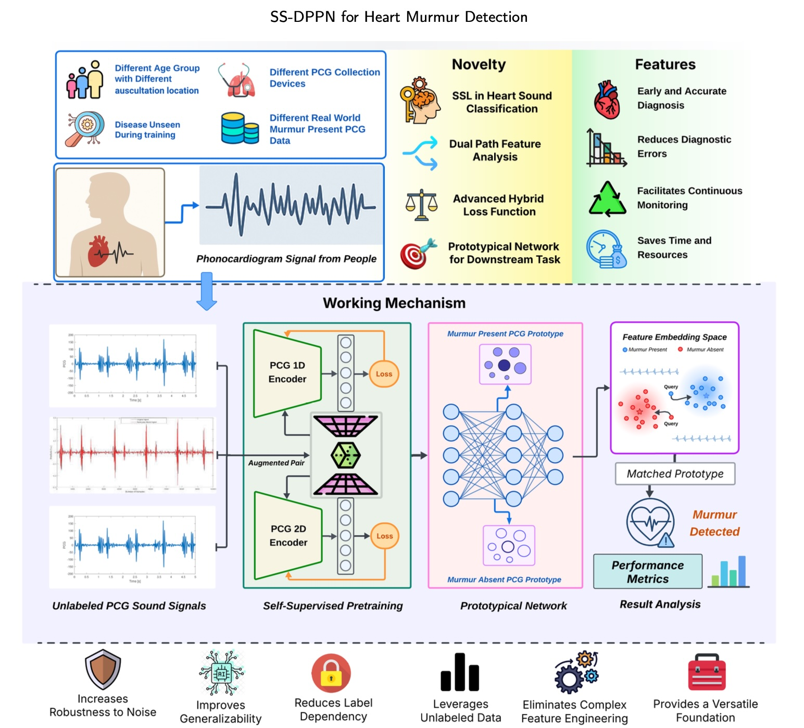
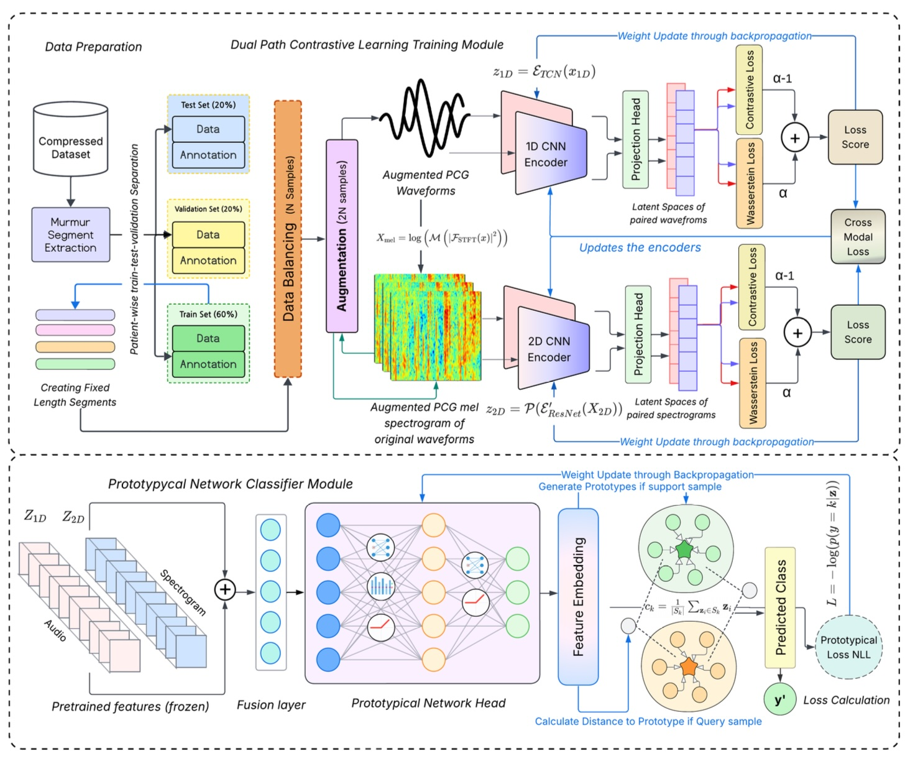
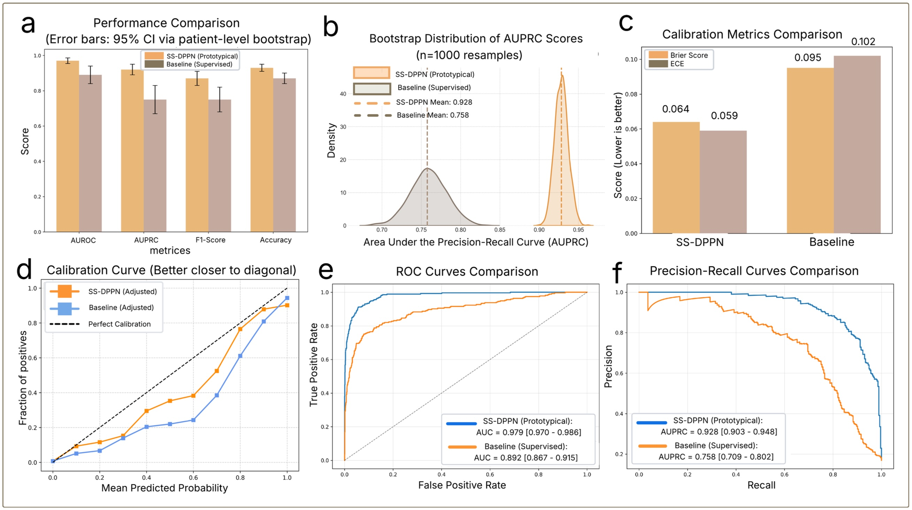

## SS-DPPN: A Dual-Path Self-Supervised Framework for Robust Heart Murmur Detection and Representation Learning

<p align="center">
  A self-supervised dual-path framework that learns cardiac audio representations from
  unlabeled phonocardiograms and classifies murmurs with a prototypical network.
</p>

<p align="center">
  <a href="https://arxiv.org/abs/2510.10719">
    
  </a>
  
  
  
</p>

<p align="center">
  <strong>Ummay Maria Muna</strong> ·
  <strong>Md. Mehedi Hasan Shawon</strong> ·
  <strong>Md. Jobayer</strong> ·
  <strong>Sumaiya Akter</strong> ·
  <strong>Md Rakibul Hasan</strong> ·
  <strong>Md. Golam Rabiul Alam</strong> ·
  <strong>M Abdullah-Al-Wadud</strong> ·
  <strong>Jia Uddin</strong>
</p>

<p align="center">
  Preprint, to be submitted to Elsevier
</p>

## Overview

Automated analysis of phonocardiograms (PCG) can support early diagnosis of cardiovascular disease, but supervised deep learning depends on large, expert-annotated datasets that are scarce and expensive to build. This repository accompanies our work on the **Self-Supervised Dual-Path Prototypical Network (SS-DPPN)**, a framework that:

- learns from unlabeled heart sounds through contrastive self-supervised pre-training;
- processes the raw 1D waveform with a dilated Temporal Convolutional Network (TCN);
- processes the 2D log-mel spectrogram with a pretrained ResNet-50;
- trains both encoders with a hybrid NT-Xent + Wasserstein loss, within and across modalities;
- fuses the two representations into a single embedding; and
- classifies murmurs with a prototypical network that is robust to the natural class imbalance of clinical data.

The framework was evaluated on **CirCor DigiScope 2022**, **PhysioNet/CinC 2016**, **PASCAL CHSC 2011**, and **HLS-CMDS**, and further tested for transfer to lung sound classification and ECG-based heart rate estimation.

<p align="center">
  
</p>

<p align="center">
  <em>
    Graphical overview of SS-DPPN, from unlabeled PCG input through dual-path
    self-supervised pre-training to prototypical-network murmur classification.
  </em>
</p>

## System architecture

<p align="center">
  
</p>

<p align="center">
  <em>
    SS-DPPN has two modules: a dual-path self-supervised pre-training module
    (top) and a prototypical-network classification module (bottom).
  </em>
</p>

The pipeline follows these stages:

1. **Murmur segment extraction** — systolic murmur intervals are extracted from the annotated recordings and mapped to their PCG signals.
2. **Fixed-length segment generation** — a rollover buffer concatenates adjacent heart sound segments of the same patient into 4000-sample (1 s) windows, with phase-aware concatenation, 50–1000 ms gap thresholds, and a 1.5× expected-cardiac-cycle limit.
3. **Patient-aware split** — patients are split 60 / 20 / 20 into train, validation, and test sets with stratification, so no patient appears in more than one split.
4. **Training data balancing** — the minority class is oversampled with randomized augmentation; validation and test sets keep their natural class distribution.
5. **Dual-path encoding** — the dilated TCN encodes the waveform and the ResNet-50 encodes its log-mel spectrogram, each followed by a projection head.
6. **Hybrid contrastive pre-training** — augmented views are pulled together with NT-Xent and aligned at the distribution level with the Wasserstein distance.
7. **Feature fusion** — the 1D and 2D embeddings are concatenated and passed through an MLP fusion layer.
8. **Prototypical classification** — with the encoders frozen, a prototypical head is trained episodically and classifies each sample by its distance to class prototypes.

## Main research contributions

- **Dual-path representation learning:** jointly learns from 1D waveforms and 2D spectrograms, capturing temporal and spectro-temporal features that single-domain methods miss.
- **Hybrid loss function:** combines the instance discrimination of NT-Xent with the distributional alignment of the Wasserstein distance for a better-structured embedding space.
- **Prototypical-network classifier:** improves minority-class (murmur) detection compared with a standard classifier under naturally imbalanced evaluation.
- **Reliability and data efficiency:** statistical analysis, calibration, data-efficiency experiments, and representation visualizations assess the consistency of the framework.

## Model details

**Dilated TCN 1D encoder.** An initial block (1D convolution with a large kernel and stride, Layer Normalization, ReLU, and average pooling) is followed by eight residual dilated blocks with dilation $d_l = 2^l$ and a final adaptive average pooling layer. Each block applies pre-activation BatchNorm and ReLU, a dilated 1D convolution, dropout, and an identity skip connection:

$$
\mathbf{x}_{l+1} = \mathrm{Dropout}\big(\mathrm{Conv1D}_{\mathrm{dilated}}(\mathrm{ReLU}(\mathrm{BN}(\mathbf{x}_l)))\big) + \mathbf{x}_l
$$

**ResNet-50 2D encoder.** A pretrained ResNet-50 processes the log-mel spectrogram. Its first convolution is modified to accept a single channel, initialized by averaging the original three-channel weights, and the final classification layer is removed. A two-layer MLP projection head with BatchNorm and Dropout maps the features to the final embedding.

**Augmentations.** Waveforms receive Gaussian noise, random circular time shifts, amplitude scaling, and time stretching/pitch shifting. Spectrograms receive time masking and frequency masking.

**Hybrid loss.** The NT-Xent loss and the entropy-regularized (Sinkhorn) squared 2-Wasserstein distance are combined as

$$
\mathcal{L}_{\mathrm{Hybrid}} = \alpha\,\mathcal{L}_{W} + (1 - \alpha)\,\mathcal{L}_{\mathrm{NT\text{-}Xent}}, \qquad \alpha = 0.3
$$

**Prototypical network.** Each class prototype is the mean embedding of its support samples, and a query is classified with a softmax over negative squared Euclidean distances to the prototypes:

$$
\mathbf{p}_c = \frac{1}{|S_c|}\sum_{(\mathbf{x}_i, y_i) \in S_c} f_\phi(\mathbf{x}_i), \qquad
p_\phi(y = c \mid \mathbf{x}_q) = \frac{\exp(-\lVert f_\phi(\mathbf{x}_q) - \mathbf{p}_c \rVert^2)}{\sum_{c'} \exp(-\lVert f_\phi(\mathbf{x}_q) - \mathbf{p}_{c'} \rVert^2)}
$$

## Training setup

| Stage | Setting |
| --- | --- |
| Self-supervised pre-training | 30 epochs, batch size 32, Adam, cosine annealing from $1 \times 10^{-3}$ |
| Hybrid loss | temperature $\tau = 0.07$, Wasserstein weight $\alpha = 0.3$ |
| Prototypical network | 50 epochs, frozen backbone, Adam, learning rate $1 \times 10^{-4}$, weight decay $1 \times 10^{-4}$, gradient clipping at 1.0 |
| Reproducibility | seed 42 for PyTorch, NumPy, and CUDA |
| Hardware | NVIDIA GeForce RTX 3060 Ti |

## Results

SS-DPPN performance across the four heart sound benchmarks:

| Dataset | Accuracy | Precision | Recall | F1-score |
| --- | ---: | ---: | ---: | ---: |
| CirCor DigiScope 2022 | **0.944** | **0.848** | **0.890** | **0.868** |
| PhysioNet/CinC 2016 | 0.881 | 0.948 | 0.898 | 0.922 |
| PASCAL CHSC 2011 | 0.851 | 0.802 | 0.864 | 0.831 |
| HLS-CMDS | 0.956 | 0.910 | 1.000 | 0.970 |

On CirCor, SS-DPPN outperforms the earlier self-supervised Listen2YourHeart approach (accuracy 0.590, F1 0.544) and remains competitive with fully supervised methods, particularly in recall.

<p align="center">
  
</p>

<p align="center">
  <em>
    Comparison with a fully supervised baseline on the CirCor test set:
    (a) metrics with 95% patient-level bootstrap CIs, (b) bootstrap AUPRC distribution,
    (c) Brier score and ECE, (d) calibration curves, (e) ROC curves, (f) precision–recall curves.
  </em>
</p>

Against the supervised baseline, SS-DPPN reaches an AUROC of **0.979** (vs. 0.892) and an AUPRC of **0.928** (vs. 0.758), with lower Brier score (0.064 vs. 0.095) and ECE (0.059 vs. 0.102). Differences in AUROC and accuracy are significant with $p < 0.001$ under the two-sided DeLong and McNemar tests.

### Ablation study

| Configuration | Accuracy | Precision | Recall | F1-score | ΔF1 |
| --- | ---: | ---: | ---: | ---: | ---: |
| Base model (1D path) | 0.805 | 0.749 | 0.704 | 0.725 | – |
| + Dual-path | 0.831 | 0.762 | 0.738 | 0.749 | +0.024 |
| + Enhanced encoders (dilated TCN, ResNet-50) | 0.851 | 0.785 | 0.749 | 0.766 | +0.017 |
| + Hybrid loss | 0.863 | 0.792 | 0.758 | 0.774 | +0.008 |
| **Full SS-DPPN** (+ prototypical network) | **0.944** | **0.848** | **0.890** | **0.868** | **+0.094** |

### Transferability and data efficiency

- **Lung sound classification:** with an encoder pretrained only on heart sounds and minimal fine-tuning, SS-DPPN reaches an F1-score of **0.897** and an AUROC of **0.947**.
- **ECG-based heart rate estimation:** MAE of **0.9743 BPM** and $R^2$ of **0.9705**.
- **Label efficiency:** with only 25% of the labeled data, SS-DPPN reaches performance that the supervised baseline only approaches with 75%, with a relative F1 improvement of over 10% in the lowest-data setting.

### Computational cost

| Metric | SS-DPPN |
| --- | ---: |
| Trainable parameters | 4.8 M |
| Model size | 18.3 MB |
| Inference latency | 35 ± 6 ms / sample |
| Throughput | 28.6 samples / s |
| Single-sample memory | ~520 MB |
| Peak batch memory | ~3.1 GB |
| Inference hardware | Intel i7-10700K, 32 GB RAM |

## Datasets

| Dataset | Description |
| --- | --- |
| [CirCor DigiScope 2022](https://physionet.org/content/circor-heart-sound/1.0.3/) | 942 patients aged 0–22, 5,282 recordings from four auscultation locations (AV, MV, PV, TV), 4 kHz, labeled murmur Present / Absent / Unknown |
| [PhysioNet/CinC 2016](https://physionet.org/content/challenge-2016/) | 3,126 PCG recordings of 5–120 s at 2 kHz, normal vs. abnormal |
| [PASCAL CHSC 2011](http://www.peterjbentley.com/heartchallenge/index.html) | noisy real-world recordings of 1–30 s, normal, murmur, artifact, and extrasystole |
| [HLS-CMDS](https://data.mendeley.com/datasets/8972jxbpmp/2) | 535 high-quality 15 s heart and lung sound recordings from a clinical manikin |

CirCor DigiScope 2022 is the primary dataset for the statistical, data-efficiency, and reliability analyses. All datasets are publicly available from their original providers.

## Environment setup

Python 3.8 or newer is recommended. A CUDA-capable GPU is strongly recommended for pre-training.

```bash
python -m venv .venv
source .venv/bin/activate
pip install -r requirements.txt
```

The core stack includes PyTorch, torchaudio, torchvision, librosa, scikit-learn, SciPy, NumPy, h5py, Matplotlib, and Seaborn. GeomLoss, UMAP, and statsmodels are optional extras for Sinkhorn Wasserstein loss, UMAP visualization, and McNemar testing.

## Paper

- [arXiv: 2510.10719](https://arxiv.org/abs/2510.10719)
